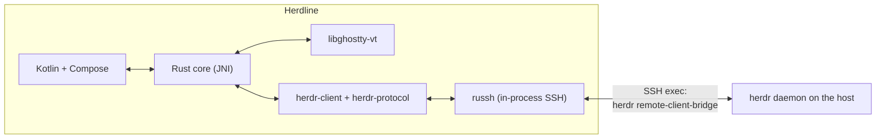

# Herdline

<picture>
  <source media="(prefers-color-scheme: dark)" srcset="branding/crook/banner-dark.svg">
  
</picture>

[Repository](https://github.com/erikfrish/herdline) · [Releases](https://github.com/erikfrish/herdline/releases) · [Add to Obtainium](https://apps.obtainium.imranr.dev/redirect?r=obtainium%3A%2F%2Fapp%2F%257B%2522id%2522%253A%2522io.github.erikfrish.herdline%2522%252C%2522url%2522%253A%2522https%253A%252F%252Fgithub.com%252Ferikfrish%252Fherdline%2522%252C%2522author%2522%253A%2522erikfrish%2522%252C%2522name%2522%253A%2522Herdline%2522%257D)

> **Release status:** the latest public APK is 0.2.0 and is not recommended
> after its partial QA found a Terminal navigation defect. Later development
> candidates are not automatically GitHub releases. Obtainium tracks published
> releases, not private APKs; adding the source is not a recommendation to install
> the failed public build.

Herdline is a native Android client for a [Herdr](https://herdr.dev/) daemon
running on a machine you reach over SSH. It is a client only: Herdr on the
host owns the terminals, workspaces, tabs, panes and agents, and they keep
running when the phone disconnects, sleeps or loses signal.

Herdline is independently developed, initially based on
[Bellterm](https://github.com/nimrc/bellterm) by Terry Wang, and released under
the Apache License 2.0. See [Origin and licence](#origin-and-licence).

> **Unaffiliated project.** Herdline is not affiliated with, endorsed by or
> supported by Bellterm, its author, Herdr or herdr.dev.

- Application ID: `io.github.erikfrish.herdline`
- Android 10 (API 29) or newer, on arm64 and x86_64. The terminal library's
  Zig code uses ELF thread-local storage, which Android's loader supports only
  from Android 10.
- English and Simplified Chinese.

<p align="center">
  <picture>
    <source media="(prefers-color-scheme: dark)" srcset="branding/crook/banner-dark.svg">
    <source media="(prefers-color-scheme: light)" srcset="branding/crook/banner-light.svg">
    
  </picture>
</p>

## Highlights

- **Sessions that outlive the phone** — Herdline attaches to a [Herdr](https://herdr.dev/)
  daemon over SSH; terminals, workspaces and agents keep running when the
  phone disconnects or sleeps.
- **Terminal you can actually type on** — Ghostty's VT renderer (via
  libghostty-vt), an extra-keys row, CJK input in place, fling scrolling,
  pinch-to-zoom, and hardware keyboard chords.
- **Composer and Chat** — per-pane drafts that survive reconnects, bracketed
  paste without Enter, and an OMP agent's transcript as a readable conversation
  with quiet tool heads and foldable summaries.
- **Reaching hosts** — jump hosts, device-generated and imported keys kept in
  the Android Keystore, SSH config import, strict host-key checking.
- **Two languages** — English and Simplified Chinese, Material 3 themes,
  checked for contrast; JetBrains Mono Nerd Font ships in the app.

## Quick start

1. **Install Herdline** (see [Install](#install)).
2. On the host, install **Herdr 0.9.0 or later**; it owns the terminals,
   workspaces and agents and keeps them running when the phone is away.
3. Copy the device's public key from
   **Settings › Security & hosts › Keys & certificates** into the host's
   `~/.ssh/authorized_keys`, and verify the host-key fingerprint on first
   connect before trusting it. Details in [Signing in](#signing-in).
4. Add the host on the start screen, attach, and pick a workspace.

## Install

Herdline is distributed as a GitHub release APK; Android 10 (API 29) or newer,
arm64 or x86_64. The release keystore is private, so updates install cleanly
only over a version signed with the same key.

**Public release status:** there is no recommended public release yet. The
latest published build, **0.2.0**, is a developer-checked candidate whose
partial runtime QA **failed** on a Terminal navigation defect (terminal
tab/pane selection can stay on the old target), so it is **not recommended**
and newer private QA builds have no published APK. Installing via Obtainium
today therefore gives you 0.2.0, or nothing while it is withheld. The
in-app updater marks 0.2.0 as failed QA and does not recommend it; nothing
is installed without an explicit tap on the device.

### Obtainium (one-click add)

<p align="center">
  <a href="https://apps.obtainium.imranr.dev/redirect?r=obtainium%3A%2F%2Fapp%2F%257B%2522id%2522%253A%2522io.github.erikfrish.herdline%2522%252C%2522url%2522%253A%2522https%253A%252F%252Fgithub.com%252Ferikfrish%252Fherdline%2522%252C%2522author%2522%253A%2522erikfrish%2522%252C%2522name%2522%253A%2522Herdline%2522%257D">
    
  </a>
</p>

[**Add Herdline to Obtainium →**](https://apps.obtainium.imranr.dev/redirect?r=obtainium%3A%2F%2Fapp%2F%257B%2522id%2522%253A%2522io.github.erikfrish.herdline%2522%252C%2522url%2522%253A%2522https%253A%252F%252Fgithub.com%252Ferikfrish%252Fherdline%2522%252C%2522author%2522%253A%2522erikfrish%2522%252C%2522name%2522%253A%2522Herdline%2522%257D)
(opens [Obtainium](https://obtainium.imranr.dev/) if installed, and offers it
if not; no silent install — Obtainium shows the config for confirmation.)

Manual fallback: in Obtainium use **Add app** with the source URL
`https://github.com/erikfrish/herdline`, or import this config as-is
(`obtainium://app/<URL-encoded JSON>` per the
[Obtainium deep-link docs](https://wiki.obtainium.imranr.dev/deep_links/)):

```json
{"id": "io.github.erikfrish.herdline", "url": "https://github.com/erikfrish/herdline", "author": "erikfrish", "name": "Herdline"}
```

### From source

See [Building](#building) below. A build you make yourself is signed with
your own key or the debug key and will not install over the published app.

## What it does

| Herdr concept | In Herdline |
| --- | --- |
| Host and session | **Hosts** on the start screen, grouped and searchable, each with a colour label. Each one names a Herdr session (`default` unless you use named sessions). Several hosts can stay attached at once. |
| Workspaces | The switcher: a bottom sheet on a phone, a sidebar on a tablet. It searches workspaces, branches, tabs, panes and agents, filters to **Needs you** or **Working**, and lists every workspace with its tabs and panes in Herdr's order. |
| Tabs | The tab row under the top bar, with each tab's status. On a phone, the Tabs button opens workspace-grouped cards or a list, with shared workspace scope, search and attention filters. Split tabs open an explicit pane picker; card previews use existing metadata, not captured terminal screenshots. |
| Panes | Drawn as Herdr lays them out, with a chip per pane when a tab has several. Split, zoom and close act on Herdr's shared layout, so the desktop sees them too, and the controls say so. |
| Agents | The **Agents** screen lists agents on every attached host by attention (**Needs you**, **Working**, **Done**, **Idle**) and can be narrowed to one workspace with the workspace filter. |

### Terminal

Herdr sends rendered cell grids, which Herdline draws through
[libghostty-vt](https://github.com/ghostty-org/ghostty): grapheme clusters,
wide characters, colours and the cursor come from Ghostty.

- The soft keyboard types straight into the pane; CJK input methods compose in
  place. An extra-keys row adds Esc, Tab, latching Ctrl and Alt, arrows,
  paging keys and symbols phone keyboards hide. Hardware keyboards work,
  including Ctrl and Alt chords.
- Drag or fling to scroll, pinch to change the font size, long-press to select
  and copy.
- Closing a pane, tab or workspace asks first, because Herdr ends the programs
  in it.

### Composer

A text field at the bottom of the session screen, so dictation, autocorrect
and multiline editing work as in any app. Nothing leaves the phone while you
write.

- Each draft belongs to one pane and is kept per host, session and pane,
  across navigation, reconnects and restarts. The composer names its
  destination; a draft for another pane says so and offers **Move here**.
- **Insert without Enter** pastes the text into the pane as one bracketed
  paste; you press Enter yourself.
- In Terminal, **Send** pastes and presses Enter once, only for an idle OMP
  agent whose complete input box can be checked. A pane sized for the desktop
  may require explicit **Fit to this phone**, which changes Herdr's shared size.
- In Chat, a compatible optional `herdline-ingress` endpoint sends directly
  into the same OMP, including steering while Working, without Fit or Enter.
  Only an absent endpoint allows terminal fallback; unsupported or uncertain
  endpoints never silently resend by another route.
- A failed or unconfirmed send preserves its draft and is never resent
  automatically. Check asks for its status; Unlock is an explicit user action.

### Attachments

Images and files can be attached to a draft for an OMP agent. After you agree
once per host, each file is copied over the same SSH connection into a folder
on that host readable only by your user, and checked on arrival. Copies older
than 7 days are removed the next time you attach. Images up to 20 MiB and
files up to 64 MiB. When a draft can't take files, the + menu says why. A
file uploaded for another pane must be uploaded again before it can be sent.

### Chat

For an OMP pane, **Chat** in the session header shows the same agent as a
conversation: Markdown and code, tool calls that open to their arguments and
output, and the agent's live status. **Terminal** switches back; both views
share the composer and its draft.

- Chat follows the pane **read here**, chosen on the phone (a tab, pane,
  switcher row, Agents row, banner or notification). It is kept apart from
  Herdr's shared focus, which the desktop and Terminal show: reading a pane in
  Chat never moves the desktop. When the desktop is elsewhere, Chat says so.
  An installed, compatible `herdline-ingress` endpoint sends directly to the
  read agent, including steering while it works, without Terminal Fit or Enter.
- Terminal shows the desktop's pane as it is. Moving the desktop takes an
  explicit action labelled as such, for example **Show ‹pane› (moves the
  desktop)**.
- Transcript reading asks Herdr which session file the pane's agent writes
  and reads that file by byte range, only under `~/.omp/agent/sessions/`.
  Chat starts no second OMP. The optional endpoint runs inside that same OMP.
- Newest messages load first; **Load older messages** brings back earlier
  ones, keeping your place.
- With the compatible endpoint, Chat renders open HTML forms and submits only
  the user's explicit answer to the exact dialog. Nested host dialogs are hidden
  while their parent is open; non-submittable dialogs have no Submit action.
  Without the endpoint, questions remain read-only and are answered in Terminal.
- Pending steering entries come from OMP's live queue, not transcript labels.
  Withdraw removes an entry only while OMP still reports it queued.
- Completed work can be folded into a summary with tool and thought counts;
  a duration appears only when transcript timestamps support it. Tool heads
  are quiet rows with one frame around their output. Prose, code and user
  bubbles use the updated spacing; dense Chat keeps its compact line height.
- **Verification:** the 0.4.0 candidate passed focused app-to-SSH-to-OMP QA
  with a local mock provider for Send, photos, the live queue, withdrawal,
  local focus/geometry, recovery and form placement. The verdict was conditional:
  a duplicated form label was fixed in 0.4.1, but read-only-dialog runtime,
  Terminal password scrollback, broad accessibility and real LLM consumption
  were not proven. 0.5.0 changes appearance controls; its proof is recorded
  separately. A build or phone installation alone is not full QA acceptance.

### Notifications

- While Herdline is open, Herdr's own "needs input" and "finished"
  notifications appear as a banner at the top of the screen. **Open** goes to
  the pane: in Chat it reads it here, in Terminal it focuses it.
- In the background they become Android notifications, with separate
  channels for attention and completions.

### Reaching hosts

- **Jump hosts**, chained as `ssh -J a,b host` does. Every hop's host key is
  checked and trusted separately.
- **Keys and certificates**: a device key generated on the phone, more
  generated keys, and imported OpenSSH private keys (RSA, ECDSA, Ed25519).
  Private keys are stored encrypted with an AES-GCM key held by the Android
  Keystore. OpenSSH user certificates can be attached to a key.
- **Passwords** can be saved per host, encrypted the same way, and are used
  for keyboard-interactive too.
- **SSH config import**: `Host` aliases become hosts, with
  `HostName`/`User`/`Port`/`ServerAliveInterval` and `ProxyJump`. `Match` and
  `Include` are reported, not applied.
- **Known hosts** lists trusted fingerprints. A changed host key is refused.

### Appearance

Material 3 and Material You choices lead the app-theme picker and are explicitly
marked; other light/dark palettes and separate terminal schemes stay available.
Launcher icons are selectable pictures of the actual adaptive icons: Wood,
Ember, Signal, Pasture, Meadow, Dusk, Mono and Contrast. JetBrains Mono Nerd Font
Mono ships in the app; additional fonts download with pinned SHA-256 checks,
and TTF/OTF imports are supported.

## Signing in

On first launch Herdline generates an Ed25519 key on the device. Copy its
public key from **Settings › Security & hosts › Keys & certificates** into the
host's `~/.ssh/authorized_keys`, or sign it with your SSH CA and attach the
certificate. The first connection to each hop shows the host key's SHA-256
fingerprint. Compare it with `ssh-keygen -lf /etc/ssh/ssh_host_ed25519_key.pub`
on that host before trusting it.

The host that runs Herdr needs `/bin/sh` and Herdr 0.9.0 or later. When Herdr
is missing or too old, the session offers to install or update it, only on
your tap. Jump hosts need only SSH with TCP forwarding allowed.

## How it works



- **Transport.** Android has no `ssh` executable, so the core uses
  [russh](https://crates.io/crates/russh) and runs the same remote bridge a
  desktop Herdr client runs through `ssh`.
- **Threads.** The Rust core owns every blocking operation, and one screen
  thread owns libghostty. The Kotlin UI thread never blocks.

| Path | Responsibility |
| --- | --- |
| `native/` | Rust core: SSH, keys, Herdr session, VT rendering, composer checks, JNI |
| `app/` | Android app: Compose screens, terminal view, storage, notifications |
| `crates/herdr-client`, `crates/herdr-protocol` | Herdr's wire protocol and client (third-party, Apache-2.0, see `NOTICE`) |

## Building

Requirements:

- JDK 17 or newer
- Android SDK with platform 37 (`compileSdk 37`)
- Android NDK 27.2.12479018
- Rust 1.96.1, pinned in `rust-toolchain.toml` with the
  `aarch64-linux-android` and `x86_64-linux-android` targets
- [cargo-ndk](https://github.com/bbqsrc/cargo-ndk)
- **Zig 0.15.2**, exactly; `libghostty-vt-sys` uses it to build the pinned
  Ghostty
- [just](https://github.com/casey/just), optional, for the recipes below

```sh
rustup target add aarch64-linux-android x86_64-linux-android
cargo install cargo-ndk --locked
# local.properties (not committed):
#   sdk.dir=/path/to/Android/Sdk
#   zig.dir=/path/to/zig-0.15.2
just build      # debug APK under app/build/outputs/apk/debug/
just test       # Rust core tests on the host, then Kotlin unit tests
```

Gradle runs cargo-ndk before every build. If Zig cannot fetch Ghostty's
dependencies, prefetch each URL it reports with `zig fetch <url>`.

### Release signing

The release build is minified. To sign it with your own key, set these
environment variables, or Gradle properties of the same names (for example in
`~/.gradle/gradle.properties`). Without them, the release build is signed with
the debug key.

```sh
keytool -genkeypair -keystore herdline-release.jks -alias herdline \
  -keyalg RSA -keysize 4096 -validity 10000
export HERDLINE_KEYSTORE=/path/to/herdline-release.jks
export HERDLINE_KEYSTORE_PASSWORD=…   # and HERDLINE_KEY_PASSWORD, if it differs
export HERDLINE_KEY_ALIAS=herdline
./gradlew assembleRelease
```

Keep the keystore and its passwords out of the repository. Every update must
be signed with the same key, or Android refuses to install it over the
existing app.

## Releases

Releases are published as
[GitHub releases](https://github.com/erikfrish/herdline/releases) of this
repository. The APK for version `VERSION` is
`https://github.com/erikfrish/herdline/releases/download/vVERSION/herdline-VERSION.apk`.

The app checks one fixed manifest,
`https://raw.githubusercontent.com/erikfrish/herdline/main/updates/latest.json`.
It lists a **stable** and a **candidate** release, each pinned to Herdline's
public release-certificate fingerprint. A candidate is marked *not tested*.
The release keystore is private; Android installs an update only over an app
signed with the same key.

## Origin and licence

Herdline is based on [Bellterm](https://github.com/nimrc/bellterm),
Copyright (c) 2026 Terry Wang, licensed under the Apache License 2.0. Herdline
keeps Bellterm's copyright and notices and adds its own changes under the same
licence. Files changed from Bellterm carry a notice that they were modified
for Herdline, beside their original copyright.

- [LICENSE](LICENSE): the Apache License 2.0.
- [NOTICE](NOTICE): Bellterm's notice and the parts that keep their own
  copyright. This covers the Herdr protocol and client crates in `crates/`
  (Apache-2.0), the colour palettes used by the themes (MIT), and the bundled
  fonts, whose licences ship beside them in `app/src/main/assets/fonts/`.
