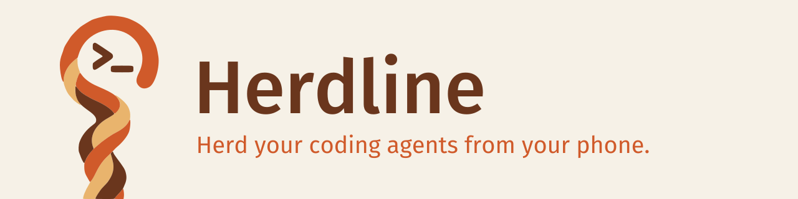
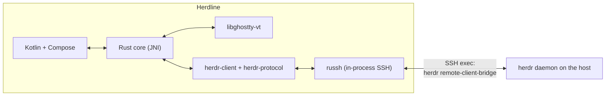

# Herdline

<picture>
  <source media="(prefers-color-scheme: dark)" srcset="branding/crook/banner-dark.svg">
  
</picture>

[Releases](https://github.com/erikfrish/herdline/releases) · [Install](#install) · [Building](#building) · [Origin and licence](#origin-and-licence)

> **Latest public release: [0.6.68](https://github.com/erikfrish/herdline/releases/tag/v0.6.68), experimental prerelease.**
> Focused emulator QA and automated checks passed with documented limits.
> Physical phones and locale behavior below Android 13 were not verified.
> Support for every agent harness and Samsung Now Bar placement remain unverified.

Herdline is a native Android client for a [Herdr](https://herdr.dev/) daemon
running on a machine you reach over SSH. It is a client only: Herdr on the
host owns the terminals, workspaces, tabs, panes and agents, and they keep
running when the phone disconnects, sleeps or loses signal.

- Application ID: `io.github.erikfrish.herdline`
- Android 10 (API 29) or newer, on arm64 and x86_64.
- English and Simplified Chinese.

## Quick start

1. **Install Herdline** (see [Install](#install)).
2. On the host, install **Herdr 0.9.0 or later**; it owns the terminals,
   workspaces and agents and keeps them running when the phone is away.
3. Copy the device's public key from
   **Settings › Security & hosts › Keys & certificates** into the host's
   `~/.ssh/authorized_keys`, and verify the host-key fingerprint on first
   connect before trusting it. Details in [Signing in](#signing-in).
4. Add the host on the start screen, attach, and pick a workspace.

## Install

Download the signed APK from Releases, or add the app to Obtainium below.
The app's own updater reads `updates/latest.json` from this repository and
checks the APK's size, SHA-256, package, version and signing certificate.
Neither updater installs silently; Android asks you to confirm the update.
Updates must use the same signing key. A self-built or debug-signed APK
cannot replace the published app without uninstalling it and losing app data.

### Obtainium (one-click add)

<p align="center">
  <a href="https://apps.obtainium.imranr.dev/redirect?r=obtainium%3A%2F%2Fapp%2F%257B%2522id%2522%253A%2522io.github.erikfrish.herdline%2522%252C%2522url%2522%253A%2522https%253A%252F%252Fgithub.com%252Ferikfrish%252Fherdline%2522%252C%2522author%2522%253A%2522erikfrish%2522%252C%2522name%2522%253A%2522Herdline%2522%252C%2522additionalSettings%2522%253A%2522%257B%255C%2522includePrereleases%255C%2522%253Atrue%257D%2522%257D">
    
  </a>
</p>

The button opens [Obtainium](https://obtainium.imranr.dev/) if installed.
Prereleases are enabled in the imported configuration; Obtainium shows it
for confirmation before adding the app.

Manual fallback: in Obtainium use **Add app** with the source URL
`https://github.com/erikfrish/herdline`, or import this config as-is
(`obtainium://app/<URL-encoded JSON>` per the
[Obtainium deep-link docs](https://wiki.obtainium.imranr.dev/deep_links/)):

```json
{"id":"io.github.erikfrish.herdline","url":"https://github.com/erikfrish/herdline","author":"erikfrish","name":"Herdline","additionalSettings":"{\"includePrereleases\":true}"}
```

## What it does

| Herdr concept | In Herdline |
| --- | --- |
| Host and session | **Hosts** on the start screen, grouped and searchable, each with a colour label. Each one names a Herdr session (`default` unless you use named sessions). Several hosts can stay attached at once. |
| Workspaces | The switcher searches workspaces, branches, tabs, panes and agents, filters to **Needs you**, **Working** or **Ready** (Idle/Done), and preserves Herdr's order. |
| Tabs | The phone Tabs sheet opens as a list. An alternate compact two-column list shares its workspace scope, search and filters. Split tabs open an explicit pane picker; no fake terminal previews. |
| Panes | Drawn as Herdr lays them out, with a chip per pane when a tab has several. Split, zoom and close act on Herdr's shared layout, so the desktop sees them too, and the controls say so. |
| Agents | The **Agents** screen lists agents on every attached host by attention (**Needs you**, **Working**, **Done**, **Idle**) and can be narrowed to one workspace with the workspace filter. |

### Terminal

Herdr sends rendered cell grids, which Herdline draws through
[libghostty-vt](https://github.com/ghostty-org/ghostty): grapheme clusters,
wide characters, colours and the cursor come from Ghostty.

- The soft keyboard types straight into the pane; CJK input methods compose in
  place. Two compact key rows add Esc, Tab, latching Ctrl and Alt, arrows,
  Enter, Backspace and shell symbols. Terminal has no Chat field; the keyboard
  types directly into the agent, including its autocomplete navigation.
- Drag or fling to scroll. Starting a one-finger vertical scroll hides the
  soft keyboard; tap the terminal to open it again. Pinch zoom and selection
  do not dismiss it. Pinch to change the font size, long-press to select and copy.
- Closing a pane, tab or workspace asks first, because Herdr ends the programs
  in it.

### Composer

A text field in **Chat mode** for dictation, autocorrect and multiline editing.
Terminal uses the agent's own editor instead. Nothing leaves the phone while
you write a Chat draft.

- Each draft belongs to one pane and is kept per host, session and pane,
  across navigation, reconnects and restarts. The composer names its
  destination; a draft for another pane says so and offers **Move here**.
- **Insert without Enter** pastes the text into the pane as one bracketed
  paste; you press Enter yourself.
- **Send** uses the supported live agent interface, or a validated empty editor
  in the same running pane. It never launches or resumes another agent, and
  refuses approvals, a remote draft or an unverifiable destination.
- In Chat, a compatible optional `herdline-ingress` endpoint sends directly
  into the same OMP, including steering while Working, without Fit or Enter.
  Only an absent endpoint allows terminal fallback; unsupported or uncertain
  endpoints never silently resend by another route.
- A failed or unconfirmed send preserves its draft and is never resent
  automatically. Check asks for its status; Unlock is an explicit user action.

### Attachments

Images and files can be attached to a draft for an OMP agent. After you agree
once per host, each file is copied over the same SSH connection into a folder
on that host readable only by your user, and checked on arrival. Copies older
than 7 days are removed the next time you attach. Images up to 20 MiB and
files up to 64 MiB. When a draft can't take files, the + menu says why. A
file uploaded for another pane must be uploaded again before it can be sent.

### Chat

**Chat** shows existing agent conversations: Markdown, tool calls, recorded
images and status. OMP, Pi, Claude Code, Codex and OpenCode have their own
readers and input routes. Kimi Code, Kilo, Grok, GitHub Copilot CLI, Qwen
legacy journals, Hermes and Mastra Code add read-only history, with differing
version and integration requirements. Reading history alone is not full
harness support.

- Chat follows the pane **read here**, chosen on the phone (a tab, pane,
  switcher row, Agents row, banner or notification). It is kept apart from
  Herdr's shared focus, which the desktop and Terminal show: reading a pane in
  Chat never moves the desktop. When the desktop is elsewhere, Chat says so.
- Terminal shows the desktop's pane as it is. Moving the desktop takes an
  explicit action labelled as such, for example **Show ‹pane› (moves the
  desktop)**.
- Transcript reading uses the exact session reference Herdr reports for the
  pane, within the reader's confined session root or bounded read-only store.
- OMP sends through its compatible ingress endpoint; Pi/Claude use a validated
  host editor, and Codex/OpenCode use their existing local control APIs. Only
  OMP exposes the live question/queue/withdrawal interface.
- Newest messages load first; **Load older messages** brings back earlier
  ones, keeping your place.
- With the compatible endpoint, Chat renders open HTML forms and submits only
  the user's explicit answer to the exact dialog. Nested host dialogs are hidden
  while their parent is open; non-submittable dialogs have no Submit action.
  Without the endpoint, questions remain read-only and are answered in Terminal.
- Pending steering entries come from OMP's live queue, not transcript labels.
  Withdraw removes an entry only while OMP still reports it queued.
- OMP task calls show their actual subagents and exact-id completion records.
  Live stages require the updated host extension: copy both
  `host/omp/herdline-ingress.ts` and `host/omp/live-subagents.ts` into the same
  extension folder, then reload your OMP explicitly. Without live events,
  persisted child snapshots still show; progress is never invented.
- Completed work can be folded into a summary with tool and thought counts;
  a duration appears only when transcript timestamps support it. Tool heads
  are quiet rows with one frame around their output. Prose, code and user
  bubbles use the updated spacing; dense Chat keeps its compact line height.
- Verification and limitations are recorded per version in the release notes;
  a build or phone installation alone is not full QA acceptance.

### Notifications

- While Herdline is open, Herdr's own "needs input" and "finished"
  notifications appear as a banner at the top of the screen. **Open** goes to
  the pane: in Chat it reads it here, in Terminal it focuses it.
- In the background they become Android notifications, with separate
  channels for attention and completions.

### Reaching hosts

- **Jump hosts**, chained as `ssh -J a,b host` does. Every hop's host key is
  checked and trusted separately.
- **Keys and certificates**: a device key generated on the phone, more
  generated keys, and imported OpenSSH private keys (RSA, ECDSA, Ed25519).
  Private keys are stored encrypted with an AES-GCM key held by the Android
  Keystore. OpenSSH user certificates can be attached to a key.
- **Passwords** can be saved per host, encrypted the same way, and are used
  for keyboard-interactive too.
- **SSH config import**: `Host` aliases become hosts, with
  `HostName`/`User`/`Port`/`ServerAliveInterval` and `ProxyJump`. `Match` and
  `Include` are reported, not applied.
- **Known hosts** lists trusted fingerprints. A changed host key is refused.

### Appearance

Material 3 and Material You choices lead the app-theme picker and are explicitly
marked; other light/dark palettes and separate terminal schemes stay available.
Launcher icons are selectable pictures of the actual adaptive icons: Wood,
Ember, Signal, Pasture, Meadow, Dusk, Mono and Contrast. JetBrains Mono Nerd Font
Mono ships in the app; additional fonts download with pinned SHA-256 checks,
and TTF/OTF imports are supported.

## Signing in

On first launch Herdline generates an Ed25519 key on the device. Copy its
public key from **Settings › Security & hosts › Keys & certificates** into the
host's `~/.ssh/authorized_keys`, or sign it with your SSH CA and attach the
certificate. The first connection to each hop shows the host key's SHA-256
fingerprint. Compare it with `ssh-keygen -lf /etc/ssh/ssh_host_ed25519_key.pub`
on that host before trusting it.

Without a specifically selected identity, Herdline first tries the device key
and can ask for a password after that key is rejected. A saved password can be
reused for that implicit-identity host. Explicit key choices never downgrade
automatically; host-key verification is unchanged.

If Herdr is missing or too old, the session offers to install or update it
only on your tap. Jump hosts need only SSH with TCP forwarding allowed.

## How it works



- **Transport.** Android has no `ssh` executable, so the core uses
  [russh](https://crates.io/crates/russh) and runs the same remote bridge a
  desktop Herdr client runs through `ssh`.
- **Threads.** The Rust core owns every blocking operation, and one screen
  thread owns libghostty. The Kotlin UI thread never blocks.

| Path | Responsibility |
| --- | --- |
| `native/` | Rust core: SSH, keys, Herdr session, VT rendering, composer checks, JNI |
| `app/` | Android app: Compose screens, terminal view, storage, notifications |
| `crates/herdr-client`, `crates/herdr-protocol` | Herdr's wire protocol and client (third-party, Apache-2.0, see `NOTICE`) |

## Building

Requirements:

- JDK 17 or newer
- Android SDK with platform 37 (`compileSdk 37`; sdkmanager package `platforms;android-37.0`)
- Android NDK 27.2.12479018
- Rust 1.96.1, pinned in `rust-toolchain.toml` with the
  `aarch64-linux-android` and `x86_64-linux-android` targets
- [cargo-ndk](https://github.com/bbqsrc/cargo-ndk)
- **Zig 0.15.2**, exactly; `libghostty-vt-sys` uses it to build the pinned
  Ghostty
- `socat` for the native ingress socket tests (`sudo apt-get install socat` on Ubuntu)
- [just](https://github.com/casey/just), optional, for the recipes below

The app currently targets SDK 36. Android's local-network runtime permission
is enforced for target SDK 37+, not merely because the device runs API 37.
Do not add or request `ACCESS_LOCAL_NETWORK` while targeting 36. A target SDK
37 migration must include the permission request before direct LAN SSH,
denial/revocation handling, and a permission-specific error rather than a
generic no-route message. See [Android's local-network permission contract](https://developer.android.com/privacy-and-security/local-network-permission).

```sh
rustup target add aarch64-linux-android x86_64-linux-android
cargo install cargo-ndk --locked
# local.properties (not committed):
#   sdk.dir=/path/to/Android/Sdk
#   zig.dir=/path/to/zig-0.15.2
just build      # debug APK under app/build/outputs/apk/debug/
just test       # Rust core tests on the host, then Kotlin unit tests
```

Gradle runs cargo-ndk before every build. If Zig cannot fetch Ghostty's
dependencies, prefetch each URL it reports with `zig fetch <url>`.

### Publication verification

The manually dispatched Release workflow first calls the repository's CI
workflow at the same source commit. Publication depends on that invocation
succeeding; it never reuses a green check from an older commit. CI checks the
Rust workspace, builds the APKs and runs the existing rendered Tabs header,
pin-sheet and Terminal IME tests on a fresh hosted emulator. These bounded
checks are not a full device regression or proof of Samsung Now Bar placement.
Release verification and ordinary push CI have separate concurrency groups.
The feed update no longer carries a skip-CI marker; GitHub's own rule that
`GITHUB_TOKEN` pushes do not trigger another workflow still applies.

### Fast changed-feature checks

Use `just check header` (or `pin`, `notifications`, `receipts`, `forms`, `terminal`)
for the changed area only. The runner executes selected test owners, fails
on failures or skipped owners, and writes timing plus logs under
`app/build/reports/fast-check/`. Its check deadline is 120 seconds; a timeout
is a failure, not a reduced test set. `just test` remains an explicit full
check, not the default after every change.

For rendered header or pin tests on an assigned emulator:

```sh
just check-ui header emulator-5558
just check-ui pin emulator-5558
just check-ui terminal emulator-5558
# For an isolated ADB server, pass its exact transport and your own wrapper:
just check-ui header localfilesystem:/bridge/guest.sock /path/to/owned-adb-wrapper
```

UI checks incrementally build the current test APKs inside the same deadline,
then install `io.github.erikfrish.herdline.qa` beside the release app. They never
uninstall or clear release data and require no SSH connection, provider or
host-agent fixture. Native libraries must already be built; UI-only checks
skip rebuilding unchanged Rust. For a cold setup, add `--prepare-ui` to the
Python runner: preparation is then measured separately. The explicit QA
variant uses `-Pherdline.testBuildType=qa`; default debug tests stay unchanged.

Measured on the warm QA2 API 37 emulator: `header --ui` passed in 19.0 s
(8 unit tests plus one real Compose test covering eight width/locale/count
combinations); `pin --ui` passed in 10.7 s (6 unit tests plus 3 Android
storage/privacy tests). Both times include incremental APK checks, installation
and instrumentation. First dependency preparation took 28.5 s separately.
Pin storage recreation is in-process; this does not claim a cold process or
live SSH end-to-end check. `terminal --ui` passed on the warm API 36 emulator
in 25.8 s (13 unit tests plus 8 real IME gesture tests). Its emulator-only
hardware-keyboard setting is enabled temporarily and restored in `finally`.
Only these three UI profiles have measured timings.

QA agents inspect only fresh functionality or a changed path after its fix.
Previously covered behavior runs through the selected automated check;
another manual regression matrix needs a separate explicit request.

### Release signing

The release build is minified. To sign it with your own key, set these
environment variables, or Gradle properties of the same names (for example in
`~/.gradle/gradle.properties`). Without them, the release build is signed with
the debug key.

```sh
keytool -genkeypair -keystore herdline-release.jks -alias herdline \
  -keyalg RSA -keysize 4096 -validity 10000
export HERDLINE_KEYSTORE=/path/to/herdline-release.jks
export HERDLINE_KEYSTORE_PASSWORD=…   # and HERDLINE_KEY_PASSWORD, if it differs
export HERDLINE_KEY_ALIAS=herdline
./gradlew assembleRelease
```

Keep the keystore and its passwords out of the repository. Every update must
be signed with the same key, or Android refuses to install it over the
existing app.

## Origin and licence

Herdline is based on [Bellterm](https://github.com/nimrc/bellterm),
Copyright (c) 2026 Terry Wang, licensed under the Apache License 2.0. Herdline
keeps Bellterm's copyright and notices and adds its own changes under the same
licence. Files changed from Bellterm carry a notice that they were modified
for Herdline, beside their original copyright.

Herdline is independently developed and is not affiliated with, endorsed by
or supported by Bellterm, its author, Herdr or herdr.dev.

- [LICENSE](LICENSE): the Apache License 2.0.
- [NOTICE](NOTICE): Bellterm's notice and the parts that keep their own
  copyright. This covers the Herdr protocol and client crates in `crates/`
  (Apache-2.0), the colour palettes used by the themes (MIT), and the bundled
  fonts, whose licences ship beside them in `app/src/main/assets/fonts/`.
