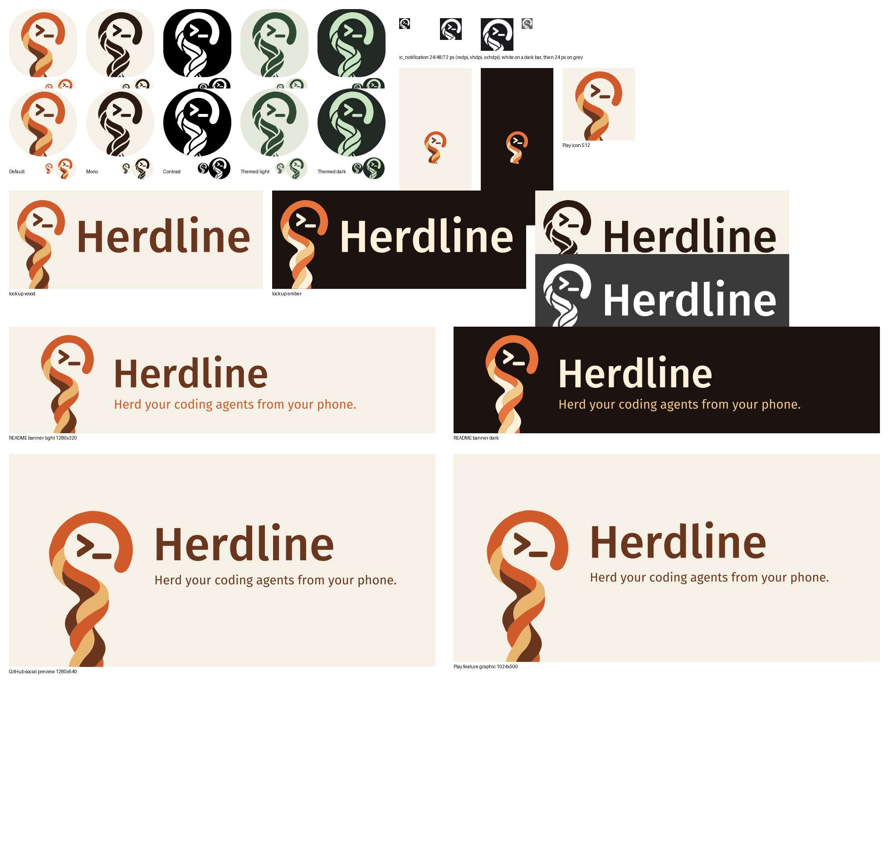

# Herdline brand

<picture>
  <source media="(prefers-color-scheme: dark)" srcset="crook/banner-dark.svg">
  
</picture>

The approved Herdline mark is a braided three-strand shepherd's crook with a
`>_` terminal prompt in its hook. The crook stands for leading a herd of coding
agents, and the shaft runs off the bottom edge on purpose. The strands are
uneven, like a hand-cut branch. The app's launcher icons, splash and
notification icon use this mark.

The overview is a set of design renders (rsvg), not screenshots from a
device.

## Colours

| Role | `wood` (main) | `ember` (dark) |
|---|---|---|
| Background | `#F6F1E7` | `#1C1310` |
| Hook, main strand | `#D05A2A` | `#E8743B` |
| Light strand | `#E9B46D` | `#F2C98A` |
| Dark strand, prompt, name | `#6A361D` | `#FFF1DC` |

One-colour uses: `#2A1A12` on `#F6F1E7` (14.9:1), or white on black.

The launcher picker also includes the prepared Signal (orange/black), Pasture
(green/cream), Meadow (mint/ink) and Dusk (violet/cream) colourways. Ember is a
separate dark-tile choice; Wood remains the default. All reuse the same path
geometry, with no new raster generation or effects.

## Files

| File | Use |
|---|---|
| [`crook/symbol.svg`](crook/symbol.svg), [`symbol-ember.svg`](crook/symbol-ember.svg), [`symbol-mono.svg`](crook/symbol-mono.svg) | the mark on the 108-unit adaptive icon grid, transparent |
| [`crook/herdline-wood.svg`](crook/herdline-wood.svg), [`herdline-ember.svg`](crook/herdline-ember.svg), [`herdline-wood-transparent.svg`](crook/herdline-wood-transparent.svg) | lockup: mark and name |
| [`crook/herdline-mono-black.svg`](crook/herdline-mono-black.svg), [`herdline-mono-white.svg`](crook/herdline-mono-white.svg) | one-colour lockup |
| [`crook/banner-light.svg`](crook/banner-light.svg), [`banner-dark.svg`](crook/banner-dark.svg) | README banner, 1280 × 320 |
| [`crook/social-preview.png`](crook/social-preview.png) | GitHub social preview, 1280 × 640 |
| [`crook/icon-512.png`](crook/icon-512.png), [`feature-graphic.png`](crook/feature-graphic.png) | store icon 512 × 512, feature graphic 1024 × 500 |

The app resources live in `app/src/main/res`:

- `values/launcher_glyph.xml` holds the path data.
- `values/colors.xml` holds the default launcher colours; `values/colors_launcher_variants.xml` holds the other prepared colourways.
- `drawable/ic_launcher_glyph*.xml` are the launcher foregrounds.
- `mipmap-anydpi/ic_launcher*.xml` contains the adaptive Wood, Ember, Signal, Pasture, Meadow, Dusk, Mono and Contrast icons.
- `drawable/ic_notification.xml` is the notification icon.
- The splash uses `drawable{,-night}/ic_splash_glyph.xml` and `values{,-night}-v31/themes.xml`.

## Icon identity in the app

The icon a person picks in Settings › Appearance is the app's identity
everywhere in app code: launcher entry (`IconVariants.apply`), the Recents
task icon (`MainActivity`), notification large icons and the in-app logo
(`IconVariants.icon`/`currentIcon` draw the variant's own adaptive art once
and cache it). Recognition-critical semantic glyphs — terminal status glyphs,
badges, navigation icons, the notification small icon the status bar tints —
stay the mark's one-colour form or their own symbols, never the variant tile.

One surface cannot follow the pick and never will: the icon in Android
Settings › App info and other system package views is fixed at install time
from the manifest (`android:icon`) and activity-alias resources. The platform
has no API to change it at runtime; only the launcher, Recents and
notifications can carry the selected variant. The Android 12+ splash is
theme-defined per day/night (`values{,-night}-v31`) and is equally static
within a theme.

## Rules

- **Safe zone:** keep the hook and prompt inside the adaptive-icon safe
  zone (they reach r 32.8 of 33 on the 108 grid). The shaft is meant to be cut
  by every mask.
- **Keep the mark as it is:** don't smooth the strands, close the hook into a
  ring, or round off the end of the shaft.
- **No effects:** don't add shadows, gradients or glow.
- **Dark tiles:** put the three-colour mark on dark tiles only in `ember`.
- **Lockup:** the name is set in Fira Sans Medium and the tagline in Fira Sans
  Regular, both converted to outlines. Minimum lockup height is 24 dp.

## Provenance and licence

The mark is a vector trace of a raster that Codex's built-in image generation
made from the maintainer's prompts, which the maintainer then approved. The
text is outlined glyphs of Fira Sans (SIL Open Font License 1.1). No font file
is distributed. No third-party artwork was used. Geometry copyright (c) 2026
erikfrish, Apache-2.0.

## Earlier explorations

[`concepts/`](concepts) holds earlier directions that were not chosen:

- [A — Lead line](concepts/a-lead-line.svg)
- [B — Pane bubble](concepts/b-pane-bubble.svg)
- [C — Converge](concepts/c-converge.svg)

They also include a [generated reference for C](concepts/c-converge-generated.png).
They are design history only, not app assets.
