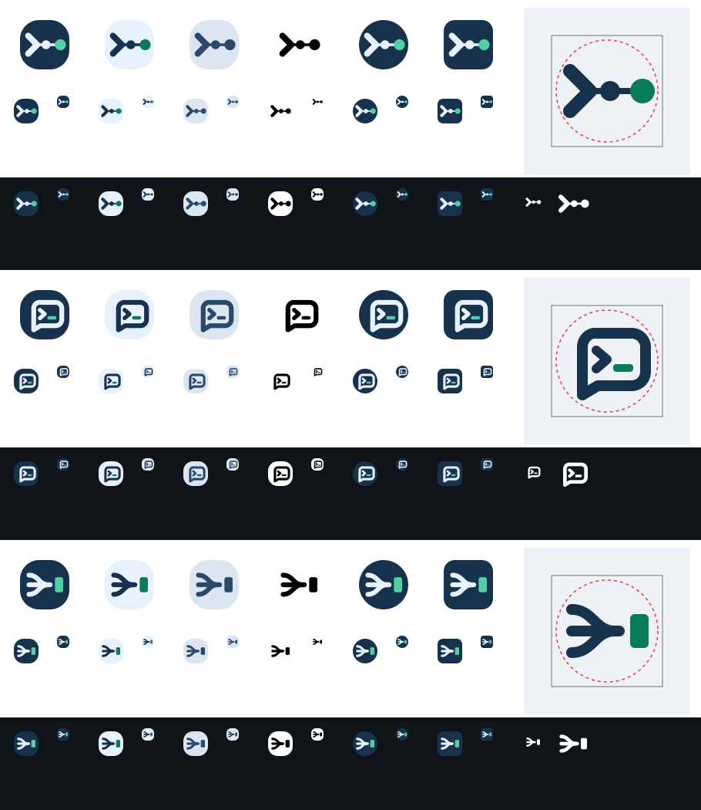

# Herdline logo concepts

These are original vector design explorations, not the integrated launcher icon.
The app currently has a provisional H/link glyph. Final design is not yet approved.

- [A — Lead line](concepts/a-lead-line.svg): terminal prompt and a line of agents.
- [B — Pane bubble](concepts/b-pane-bubble.svg): chat and terminal in one mark.
- [C — Converge](concepts/c-converge.svg): several agent threads merge into one line ending at a block cursor; designer recommendation.

Geometry copyright (c) 2026 erikfrish, Apache-2.0. No third-party artwork.
The proof sheet shows light/dark, monochrome, launcher masks and 24/48 px renders;
it is not a screenshot from a device. Raster generation did not produce a result;
the SVG geometry was hand-authored and rendered locally. Authentication logs are not distributed.
