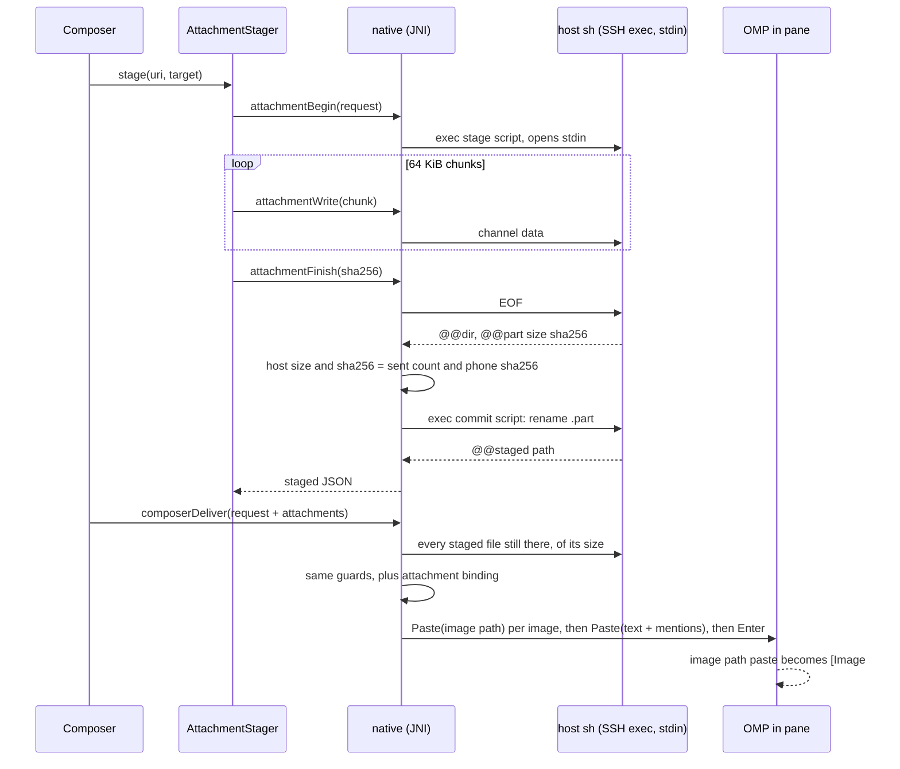

# Attachments

An attachment is a file the user picks on the phone. Its bytes go to the
Herdr host over the SSH session that already runs the bridge, and nowhere
else. The draft then names the staged host path. An image is recognised by
the OMP running in the target pane as `[Image #N]`. Any other file is
mentioned as `@"/abs/path"`.

## Acceptance

- **IMAGE is required.** A PNG, JPEG, GIF or WebP picked on the phone must
  reach the same running OMP that the draft targets, and OMP must show it
  as `[Image #N]`. Delivering a path as text is not enough.
- **Any other file** is staged on the host. The draft mentions it as
  `@"<path>"`, which OMP's mention parser reads
  (`pi-coding-agent/src/utils/file-mentions.ts`, `FILE_MENTION_REGEX`).
- **Streaming.** Bytes are streamed from the content URI in 64 KiB chunks. A
  file is never read into memory whole.
- **No third-party upload.** No relay, cloud or Herdr's
  `ClipboardImage`; see [Why not ClipboardImage](#why-not-clipboardimage).
- **Asked first, per host.** Before the first pick for a host, a dialog names
  the host, the staging root and the seven-day removal. Cancel opens no
  picker and uploads nothing. The answer is kept per saved server (its id,
  user, address, port and jump route), so it never covers another host.
- **Staging is private.** Each upload goes to its own 0700 directory inside a
  0700 per-user root that the user owns and that is not a symlink. Files are
  written with umask 077 and noclobber.
- **Safe names.** The phone-side name is reduced to `[A-Za-z0-9._-]`, with no
  leading dot and at most 80 characters, so the host never sees a traversal
  or a quote. The host repeats every check.
- **Limits.** Images may be at most 20 MiB, OMP's `MAX_IMAGE_INPUT_BYTES`
  (`pi-tui/src/chat/image-loading.ts`). Other files may be at most 64 MiB.
  The host enforces the limit with `head -c limit+1`.
- **Verified.** Staging succeeds only when the size and SHA-256 computed on the
  host equal the ones the phone computed while it streamed.
- **Cancel cleans up.** A cancel or any failed check removes the upload's
  directory on the host, and Remove after staging deletes it. What a lost
  link leaves behind is swept when the next upload starts.
- **Bound to its target.** A staged attachment is bound to its node, Herdr
  session, daemon run (`boot`), pane and OMP instance. Send refuses it for
  any other target.
- **Never resent.** A reconnect, a changed target or an uncertain delivery
  never re-sends an attachment automatically. The draft keeps it and the
  user decides.
- **Guards stay.** Every existing Send guard stays: the hold, the receipt,
  the instance check on the host, the viewport gate and the 12-row guard.
  The attachment checks are added before them, never instead of them.

## Flow

## Composer

The + menu leads with **Attach image** (the system Photo Picker, images
only) and **Attach file** (`OpenMultipleDocuments`, any type), each with
its limit as a help line. While the draft can't take files they stay,
disabled, and the help line names why: not connected, the draft is held or
sending, the pane must be confirmed again, the pane has no OMP whose
instance was read, or the draft already holds its 10 files
(`attachBlock`; null exactly where files may be attached).

- **Chips.** In the Regular fit each file is a 48 dp chip above the field,
  at most 260 dp wide: a 36 dp thumbnail that the provider decodes off the
  main thread (a glyph for other files), the name, its state (uploading %,
  the size in KiB/MiB and type, not uploaded, failed with the reason), and
  Remove. A chip not uploaded for this target uploads again when tapped,
  except one refused as too large. A state change is announced politely,
  an upload's progress in 25 % steps. One line names the host the files go
  to. Compact and Side have no chip row: the To-line leads with the files'
  state instead, "Uploading k of n…", "k upload failed", "k not uploaded
  here" or "n attachments" (`attachmentsLine`), also while the strip names
  another destination.
- **Durable.** Attachments are stored in the draft (`DraftAttachment`), with
  the content URI under a persisted read grant where the provider gives one
  and the staged host copy with its binding. An upload under way is not
  stored: after a restart or on leaving the pane, it reads back as not
  uploaded, and uploads again only on the user's tap.
- **Held until ready.** Send and Insert stay off until every file is staged
  for exactly the draft's target (`attachmentsState`). After a rebind,
  move or new agent instance, the earlier copy no longer counts. Steer is
  off while the draft has files.
- **Sent once.** A confirmed delivery takes its files out of the draft. A
  refused or uncertain one keeps them, and the hold applies as for text.
- **Remove** cancels an upload under way and deletes a staged copy from the
  host.

## Host staging

The root is a per-user directory under `$HOME/.cache` (`ROOT` in
`native/src/attach.rs`). The script refuses unless the root:

- resolves to an absolute path made only of `[A-Za-z0-9._/-]`, because that
  path is pasted into OMP;
- is a directory and not a symlink (`[ -d ] && [ ! -L ]`);
- is owned by the user (`[ -O ]`) and has mode 0700.

Each upload gets `mktemp -d "$root/XXXXXXXXXX"`. Stdin goes through
`head -c limit+1` into `$dir/<name>.part` under `set -C`. The script reports
the directory, then the size and the SHA-256 (`sha256sum`, else
`shasum -a 256`). The native core compares them with the bytes it sent and
the phone's SHA-256. Only when both match does a second command rename the
file to `$dir/<name>`, after checking that `$dir` is one directory directly
inside the root. Any other end removes `$dir`.

When the next upload starts, directories older than seven days are removed,
and so is every directory whose `.part` is older than an hour (a lost link).
OMP reads an image when it is pasted. A `@path` file may be read later in the
turn, so it gets the longer window.

## Delivery

`composerDeliver`'s request gains `attachments`, a list of staged
attachments. The native core:

1. Refuses `attachment_target` unless every attachment's binding equals the
   request's `node`, `session`, `boot`, `pane` and `instance`, and its path
   is `<dir>/<name>` with a safe name. The request must name an OMP instance
   (`attachment_needs_agent`). Text may be empty only beside attachments.
2. Runs every existing check unchanged: hold, steer, receipt, the instance read
   on the host, and `admit` with the viewport.
3. Checks on the host that every staged file is still a regular file of its
   size, else refuses `attachment_missing`: OMP drops an image path it cannot
   read and would still take the Enter.
4. Queues one `Paste(path)` per image, in order. Then it queues one `Paste`
   with the draft text and a ` @"<path>"` per file, if either is non-empty,
   then Enter when submitting. The receipt request follows, as today.

OMP routes a bracketed paste whose whole payload is one absolute image path
to `onPasteImagePath` (`pi-tui/src/prompt/custom-editor.ts`,
`#routeBracketedPaste`, `extractImagePastePathsFromText`). That path then
goes to `handleImagePathPaste` (`pi-coding-agent/src/modes/controllers/input-controller.ts`),
which loads it and attaches `[Image #N]`. Input that arrives while the
image loads is queued until it settles (`#pasteInFlight`, `#pendingInput`).
So the Enter after it cannot submit without the image.

Unproved: each `ClientPaneInputEvent::Paste` is assumed to reach the pane as
its own bracketed paste, which Herdr's server source would have to confirm.
If two pastes were merged into one, OMP would get the path as plain text, and
the transcript would show no `Image` block. Check for `[Image #N]` after
sending an image together with text.

Steers carry no attachments: `composerSteer` refuses a request that has
attachments (`attachment_steer`).

## JNI contract

These are declared in `core/Native.kt` (under the app's Kotlin package in
`app/src/main/java/`) and implemented in `native/src/jni_api.rs`.

| Call | Blocks | Answer |
|---|---|---|
|`attachmentBegin(id, requestJson): String`|yes|`{"outcome":"open","upload":N}` or `{"outcome":"refused","reason":…}`|
|`attachmentWrite(upload, bytes, length)`|yes, backpressure|throws `IOException` once the upload failed or was cancelled|
|`attachmentFinish(upload, sha256): String`|yes|`{"outcome":"staged","attachment":{…}}` or `refused`|
|`attachmentCancel(upload)`|no|idempotent; the host removes the directory|
|`attachmentDiscard(id, attachmentJson)`|yes|removes a staged attachment's directory|

The fields of the `attachmentBegin` request are:

- `node`, `session`, `boot`, `pane`, `instance`: the composer target;
- `name`: the safe name;
- `kind`: `image` or `file`;
- `size`: the size the provider reports, or `null`.

A staged attachment has these fields:

- `kind`, `name`;
- `path`: absolute, `[A-Za-z0-9._/-]` only;
- `size`, `sha256`;
- the binding fields above.

Refusal reasons are:

- `not_connected` (Kotlin only): no live link to stage on;
- `no_exec`: the link has no SSH session for commands;
- `target_changed`: the session or daemon run is not this link's;
- `needs_agent`: the target names no OMP instance;
- `too_large`;
- `bad_name`;
- `staging_unsafe`: the root or the directory fails a check;
- `mismatch`: the size or the SHA-256;
- `no_tools`: no `sha256sum`/`shasum`, `mktemp`, `head`, `wc`, `cut` or `find`;
- `cancelled`;
- `failed`: the host's answer could not be read.

The Kotlin side is `core/AttachmentStager.kt`. It opens the URI with
`ContentResolver.openInputStream` and streams chunks while it hashes them.
It reports progress and maps coroutine cancellation to `attachmentCancel`.

## Why not ClipboardImage

`herdr_client` supports `ClipboardImage` uploads of up to 16 MiB
(`crates/herdr-client/README.md`). How Herdr's server delivers them into a
pane, and whether OMP then sees an image, cannot be proved without Herdr's
server source. The SSH exec plus a path paste uses only paths that are
proved above in OMP's source.

---

Herdline documentation. Copyright (c) 2026 erikfrish. Licensed under the
Apache License, Version 2.0.
